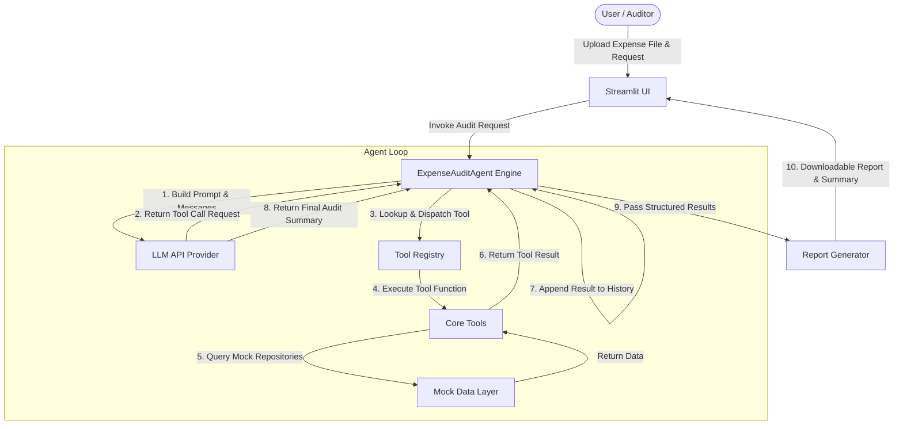

# ARCHITECTURE.md - AI Expense Audit Agent Architecture

This document outlines the architectural design, agent loop mechanics, tool contracts, data flows, and safety principles of the **AI Expense Audit Agent**.

---

## 1. System Context & Component Interaction

The AI Expense Audit Agent is designed as a modular Python application centered around an LLM function-calling orchestration loop.



---

## 2. Core Agent Loop Mechanics

The agent does **not** rely on static hardcoded if/else rules for determining audit steps. Instead, it operates using an explicit **Tool Calling Loop**:

```
Loop Step:
  1. Input: System Prompt + Audit Request + Conversation/Tool History.
  2. Call LLM with registered tool schemas.
  3. LLM returns either:
     a) Tool Call Request(s) (name, parameters).
     b) Final Response Text.
  4. If Tool Call:
     - Log action details to UI activity stream.
     - Validate tool parameters against Pydantic models.
     - Execute python tool function.
     - Capture tool execution output (success or structured error).
     - Append tool output to message history as role="tool".
     - Repeat loop.
  5. If Final Response:
     - Parse structured findings.
     - Generate Audit Summary & Findings object.
     - Terminate loop.
```

---

## 3. Tool Specs & Responsibilities

The agent is equipped with a small, focused set of tools:

| Tool Name | Parameters | Responsibility | Primary Data Source |
| :--- | :--- | :--- | :--- |
| `get_employee_details` | `employee_id` or `employee_name` | Resolves employee profile, grade, department, and direct manager. | `employees.json` |
| `read_expense_report` | `employee_id`, `start_date`, `end_date` | Reads submitted expense line items. | `expenses.csv` |
| `search_expense_policy` | `category`, `employee_grade` | Retrieves specific reimbursement caps, receipt rules, and approval criteria. | `policies.json` |
| `check_approval` | `employee_id`, `expense_category`, `date`, `amount` | Checks whether an exception was granted and pre-approved by a manager. | `approvals.json` |
| `calculate` | `operation` (`add`, `subtract`, `multiply`, `divide`, `percentage`), `a`, `b` | Performs accurate financial math (e.g. excess amount = claimed - policy limit). | Pure Code Execution |
| `read_receipt` | `receipt_id` or `file_path` | Extracts metadata (vendor, date, total amount, line items) from receipt images/files. | Mock/Multimodal Parser |

---

## 4. Expense Classification Engine

Every analyzed line item receives one of the following canonical status classifications:

* `COMPLIANT`: Within policy limits, valid category, correct receipts (if applicable).
* `POLICY_EXCEPTION`: Exceeds policy limit, but has verified manager approval.
* `MISSING_APPROVAL`: Exceeds policy limit and lacks valid manager approval.
* `RECEIPT_MISMATCH`: Claimed amount or date differs from the receipt documentation.
* `MISSING_DOCUMENT`: Policy requires a receipt or document, but none was provided.
* `REQUIRES_REVIEW`: Ambiguous context, duplicate claims, or missing employee profile requiring human auditor intervention.

---

## 5. Architectural Guarantees & Reliability Design

1. **Precision Math (No LLM Math Hallucination):**
   The system prompt explicitly instructs the LLM that any arithmetic calculations (excess calculation, variance, percentage calculation) **must** be performed by invoking `calculate`.

2. **Evidence Preservation:**
   Each `AuditFinding` object captures explicit supporting evidence:
   - Claimed amount vs allowed limit
   - Approval reference ID (if approved)
   - Policy clause citation
   - Receipt total variance (if applicable)

3. **Graceful Error Handling:**
   Tools handle missing fields or non-existent IDs gracefully by returning structured error payloads (`ToolResult(success=False, error="...")`), enabling the LLM to report missing data accurately without crashing.

4. **UI Stream Decoupling:**
   The agent emits lightweight status notifications (`AgentStep`) to the Streamlit UI, hiding raw system prompts and raw API tokens while presenting a clean, professional audit progress feed.
